# Customize Plot Appearance

This vignette shows how the plots created by the `sjp.*` and
[`plot_model()`](https://strengejacke.github.io/sjPlot/reference/plot_model.md)
functions of the **sjPlot** package can be customized.

The examples refer to
[`plot_grpfrq()`](https://strengejacke.github.io/sjPlot/reference/plot_grpfrq.md),
but most arguments are similar across all plotting function of the
**sjPlot** package.

## Tweaking plot appearance

The base function to globally change theme option for all sjp-function
is
[`sjPlot::set_theme()`](https://strengejacke.github.io/sjPlot/reference/set_theme.md).
Except for geom-colors and geom-sizes, all theme-options can be set via
this function. This new theme will be applied to all following plots
created with the **sjPlot** package.

There are various arguments to change colors, sizes, angles etc. of
labels. Following example show changes to colors, sizes, angles,
geom-outlines and theme.

``` r

# load libraries
library(sjPlot)  # for plotting
library(sjmisc)  # for sample data
library(ggplot2) # to access ggplot-themes

# load sample data set
data(efc)

sjPlot::set_theme(
  geom.outline.color = "antiquewhite4",
  geom.outline.size = 1,
  geom.label.size = 2,
  geom.label.color = "grey50",
  title.color = "red",
  title.size = 1.5,
  axis.angle.x = 45,
  axis.textcolor = "blue",
  base = theme_bw()
)

plot_grpfrq(
  efc$e42dep,
  efc$e16sex,
  title = NULL,
  geom.colors = c("cadetblue", "coral"),
  geom.size = 0.4
)
```

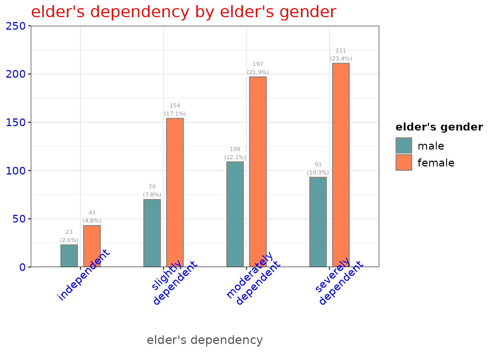

## Using the Color Brewer palettes

All plotting functions support the usage of the
[Colorbrewer](https://colorbrewer2.org/) palettes. To apply a color
brewer palette, use specify the palette as `geom.colors`. Any valid
color brewer palette is recognized automatically.

``` r

# blank theme
sjPlot::set_theme(
  base = theme_blank(),
  axis.title.size = .9,
  axis.textsize = .9,
  legend.size = .7,
  legend.title.size = .8,
  geom.label.size = 3
)

plot_grpfrq(
  efc$e42dep,
  efc$e15relat,
  geom.colors = "PuRd",
  show.values = FALSE
)
```

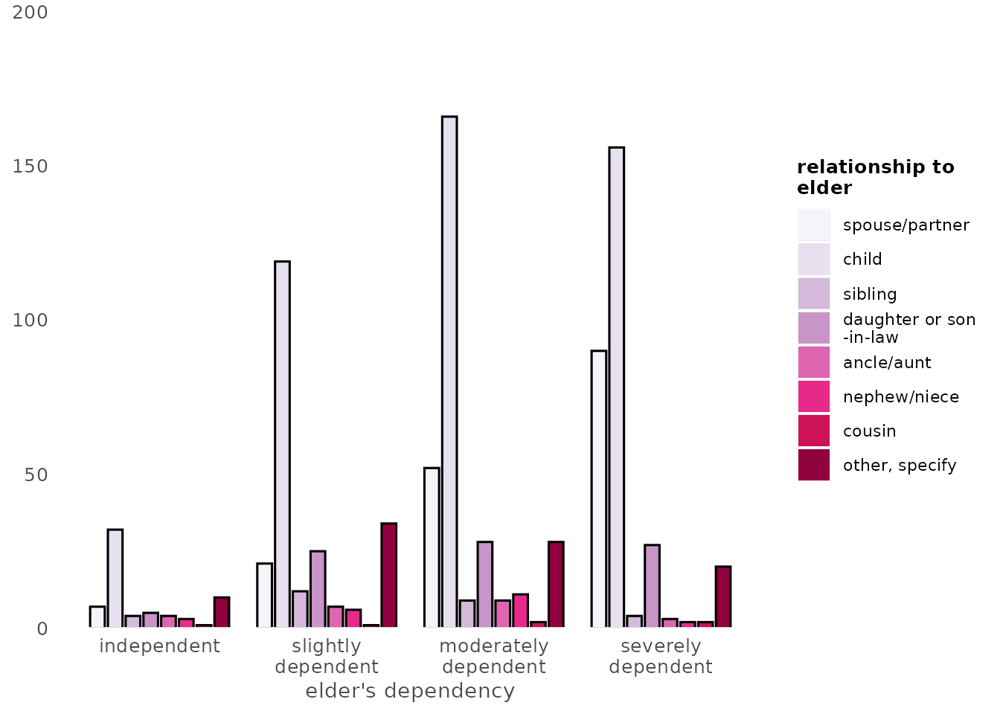

An overview of all supported color codes can be obtained with
[`display.brewer.all()`](https://rdrr.io/pkg/RColorBrewer/man/ColorBrewer.html)
from the `RColorBrewer` package.

``` r

library(RColorBrewer)
display.brewer.all()
```

## Plot with flipped coordinates

The plot’s axes can be flipped using `coord.flip = TRUE`. If needed,
labels can be placed inside the bars with the `vjust` or `hjust`
arguments. In such cases, you might need to adjust the label colors with
`geom.label.color = "white"`.

``` r

sjPlot::set_theme(geom.label.color = "white", geom.label.size = 3)

# labels appear very large due to export metrics
plot_grpfrq(efc$e42dep, efc$e16sex, coord.flip = TRUE)
```

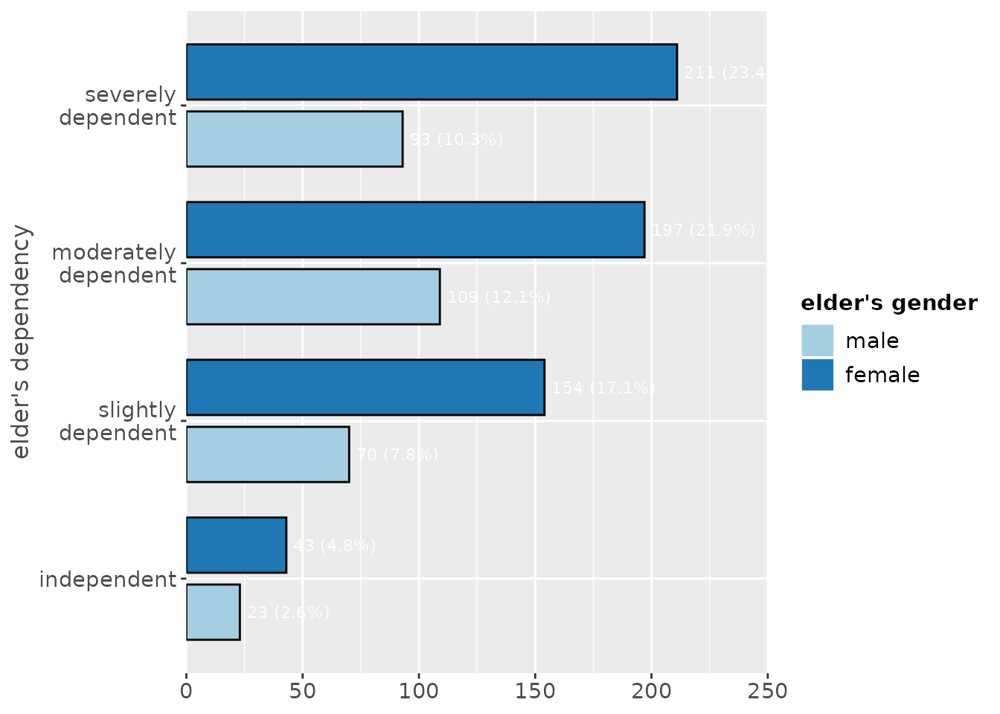

## Adding plot margins

Plots with no margins towards the axes may look strange to some people
(not to me, though). To restore the ggplot-default behaviour, use the
`expand.grid` argument:

``` r

plot_grpfrq(efc$e42dep, efc$e16sex, expand.grid = TRUE)
```

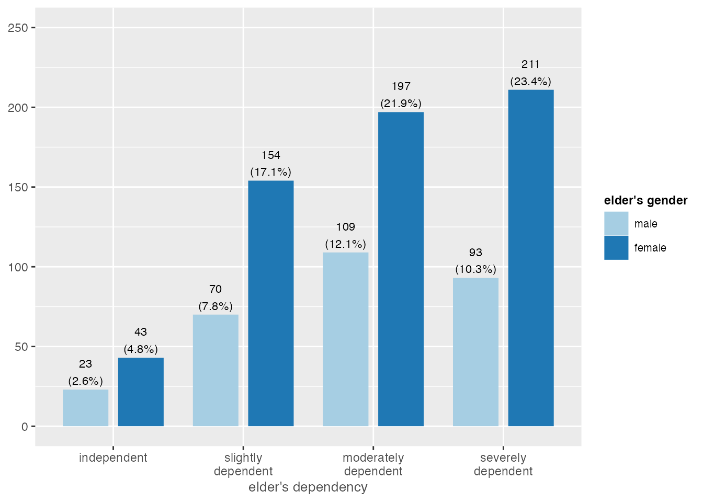

## Theme options

You can use any pre-defined theme from ggplot, like
[`theme_bw()`](https://ggplot2.tidyverse.org/reference/ggtheme.html),
[`theme_classic()`](https://ggplot2.tidyverse.org/reference/ggtheme.html)
or
[`theme_minimal()`](https://ggplot2.tidyverse.org/reference/ggtheme.html)
as default theme.

``` r

sjPlot::set_theme(base = theme_light())
plot_frq(efc$e42dep)
```

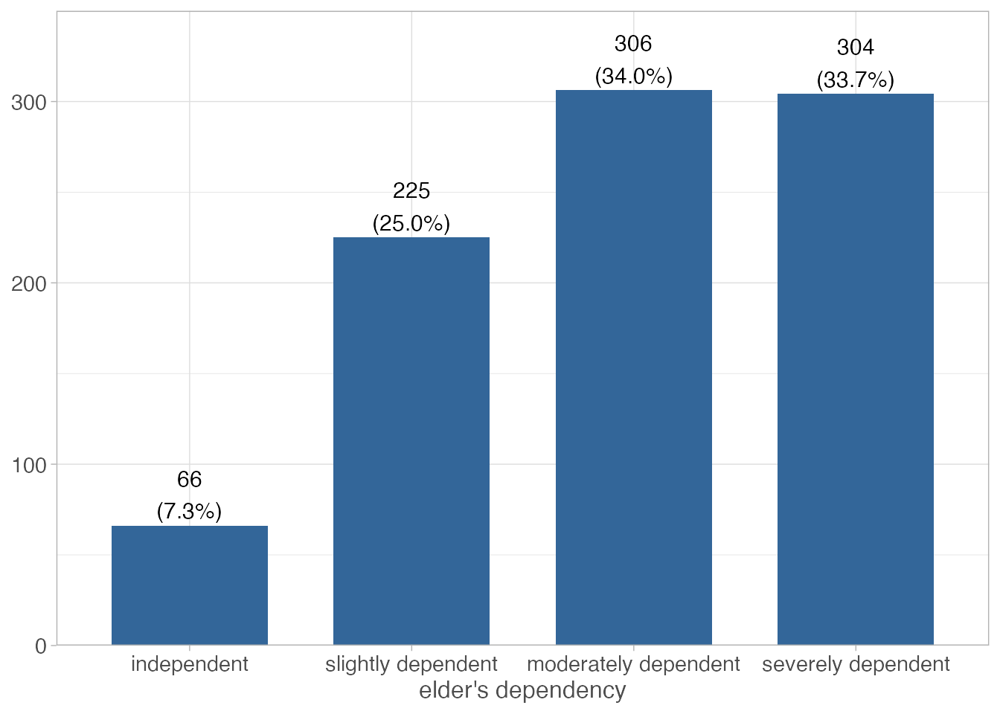

## Pre-defined themes

There is a set of pre-defined themes from the sjPlot-package. See
[`?"sjPlot-themes"`](https://strengejacke.github.io/sjPlot/reference/sjPlot-themes.md)
for a complete list.

``` r

library(sjmisc)
data(efc)
efc <- to_factor(efc, e42dep, c172code)
m <- lm(neg_c_7 ~ pos_v_4 + c12hour + e42dep + c172code, data = efc)

# reset theme
sjPlot::set_theme(base = theme_grey())

# forest plot of regression model
p <- plot_model(m)

# default theme
p
```

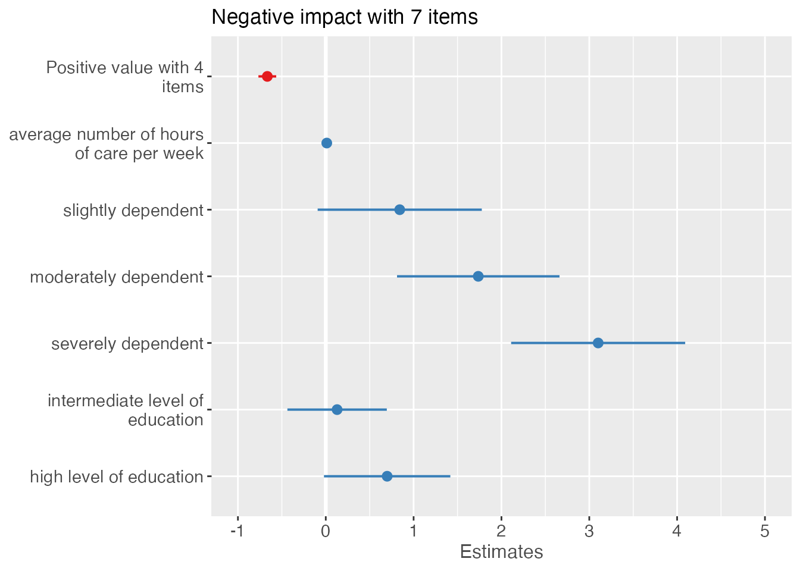

``` r

# pre-defined theme
p + theme_sjplot()
```

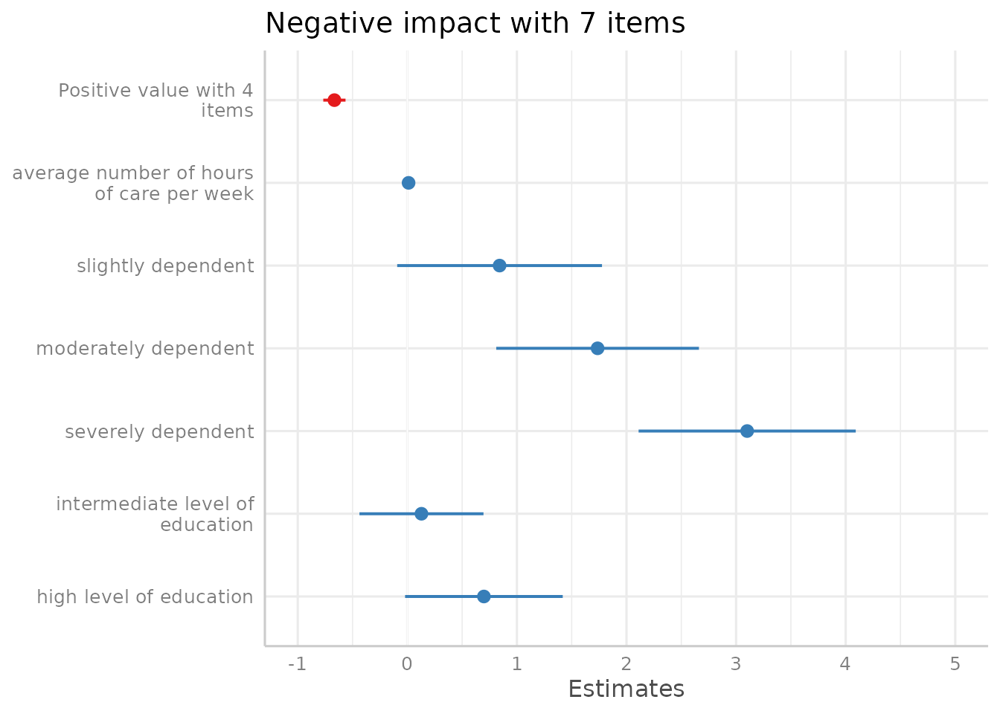

## Pre-defined scales

There is also a new scale for **ggplot**-objects,
[`scale_color_sjplot()`](https://strengejacke.github.io/sjPlot/reference/sjPlot-themes.md)
and
[`scale_fill_sjplot()`](https://strengejacke.github.io/sjPlot/reference/sjPlot-themes.md).

``` r

p +
  theme_sjplot2() +
  scale_color_sjplot("simply")
```

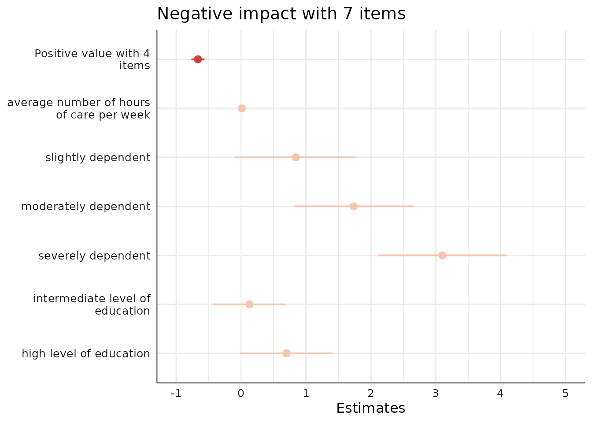

To see all currently available color sets, use
[`show_sjplot_pals()`](https://strengejacke.github.io/sjPlot/reference/sjPlot-themes.md).

``` r

show_sjplot_pals()
```

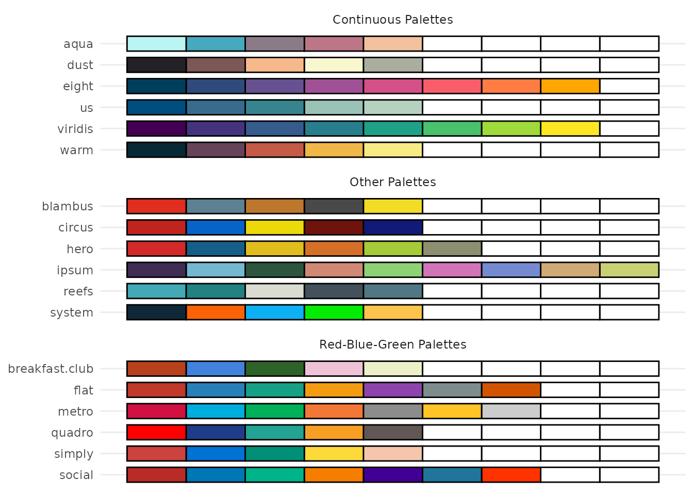

## Set up own themes based on existing themes

If you want to use a specific theme as base for building your own theme,
use the `base` argument. When using `base` instead of `theme`, further
arguments for settings colors etc. are not ignored.

``` r

sjPlot::set_theme(base = theme_bw(), axis.linecolor = "darkgreen")
plot_frq(efc$e42dep)
```

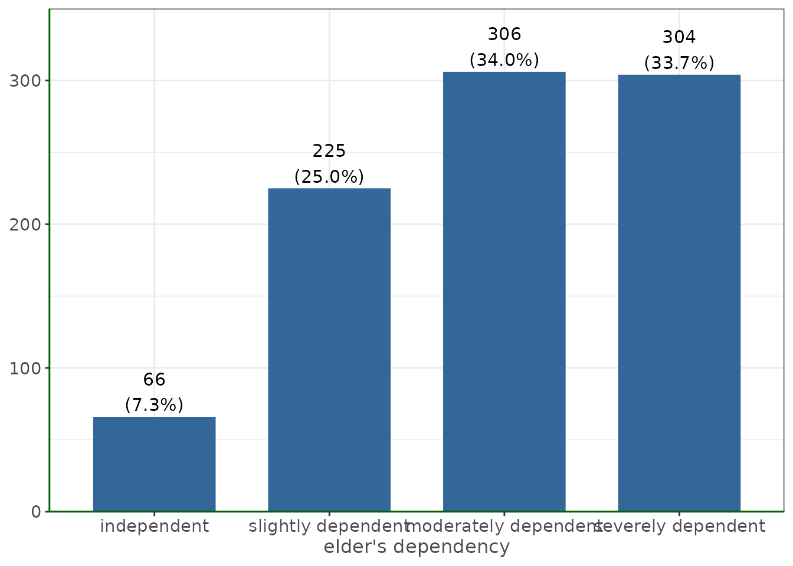

## Further customization options

Each plotting function invisibly returns the ggplot-object. You can
further add options to customize the appearance of the plot, like in the
following example, where the count axis is hidden (color set to white):

``` r

sjPlot::set_theme(
  base = theme_classic(),
  axis.tickslen = 0, # hides tick marks
  axis.title.size = .9,
  axis.textsize = .9,
  legend.size = .7,
  legend.title.size = .8,
  geom.label.size = 3.5
)

plot_grpfrq(
  efc$e42dep,
  efc$e16sex,
  coord.flip = TRUE,
  show.axis.values = FALSE
) +
  theme(axis.line.x = element_line(color = "white"))
```

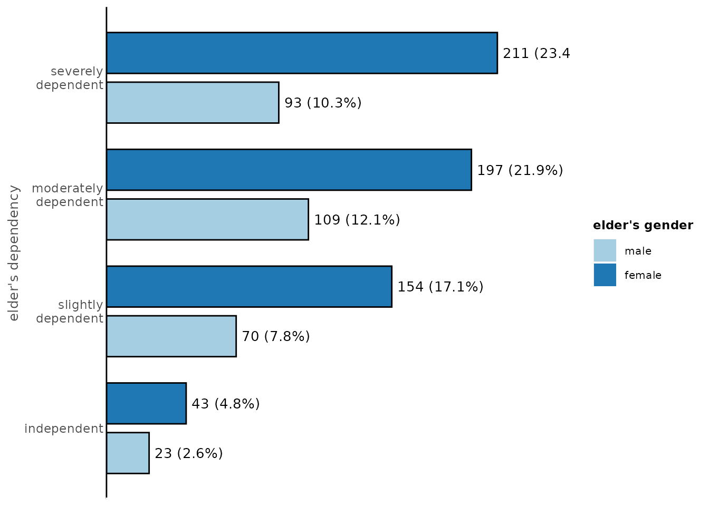

## Plot legend

The plot’s legend can be customized via various `legend.`-arguments, see
following examples:

``` r

sjPlot::set_theme(
  base = theme_classic(),
  legend.title.face = "italic", # title font face
  legend.inside = TRUE,         # legend inside plot
  legend.color = "grey50",      # legend label color
  legend.pos = "bottom right",  # legend position inside plot
  axis.title.size = .9,
  axis.textsize = .9,
  legend.size = .7,
  legend.title.size = .8,
  geom.label.size = 3
)

plot_grpfrq(efc$e42dep, efc$e16sex, coord.flip = TRUE)
```

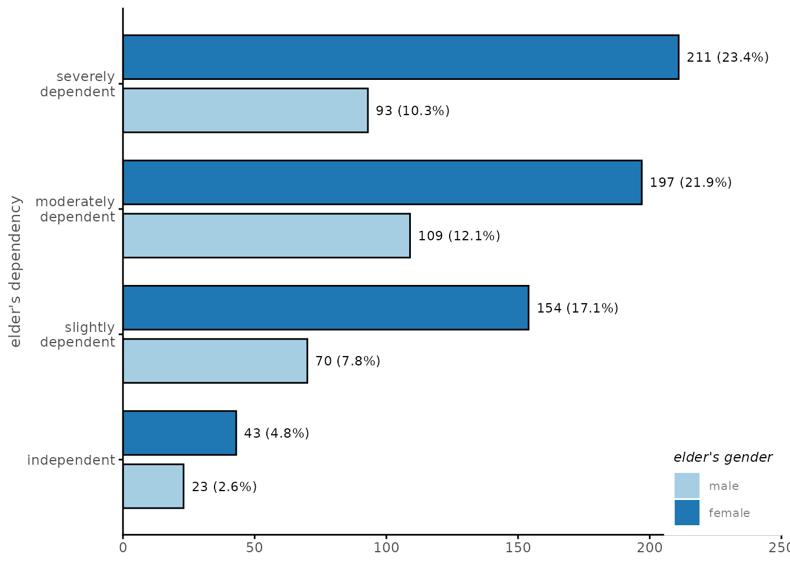

``` r

sjPlot::set_theme(
  base = theme_classic(),
  axis.linecolor = "white",     # "remove" axis lines
  axis.textcolor.y = "darkred", # set axis label text only for y axis
  axis.tickslen = 0,            # "remove" tick marks
  legend.title.color = "red",   # legend title color
  legend.title.size = 2,        # legend title size
  legend.color = "green",       # legend label color
  legend.pos = "top",           # legend position above plot
  axis.title.size = .9,
  axis.textsize = .9,
  legend.size = .7,
  geom.label.size = 3
)

plot_grpfrq(efc$e42dep, efc$e16sex)
```

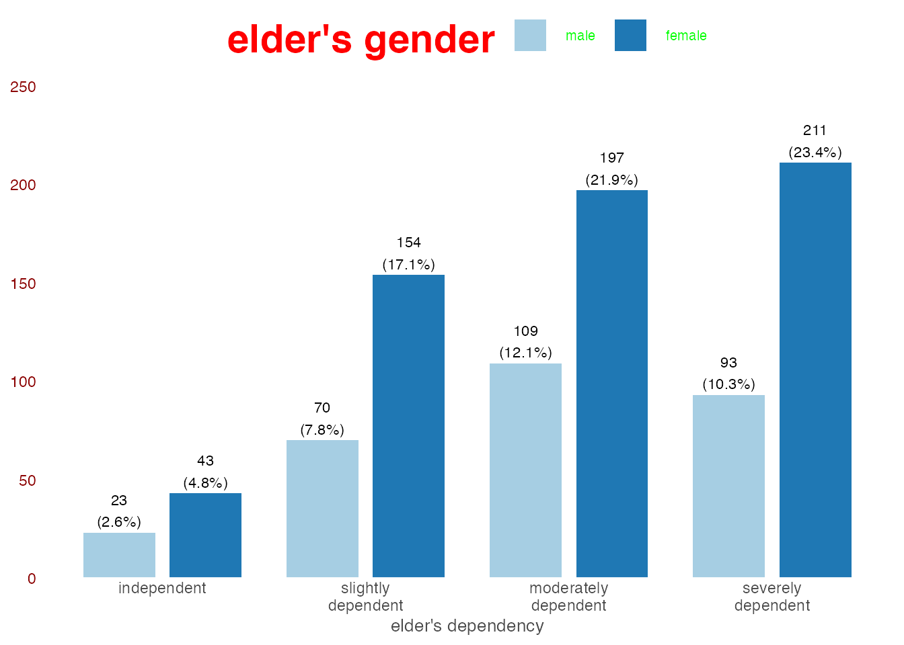
