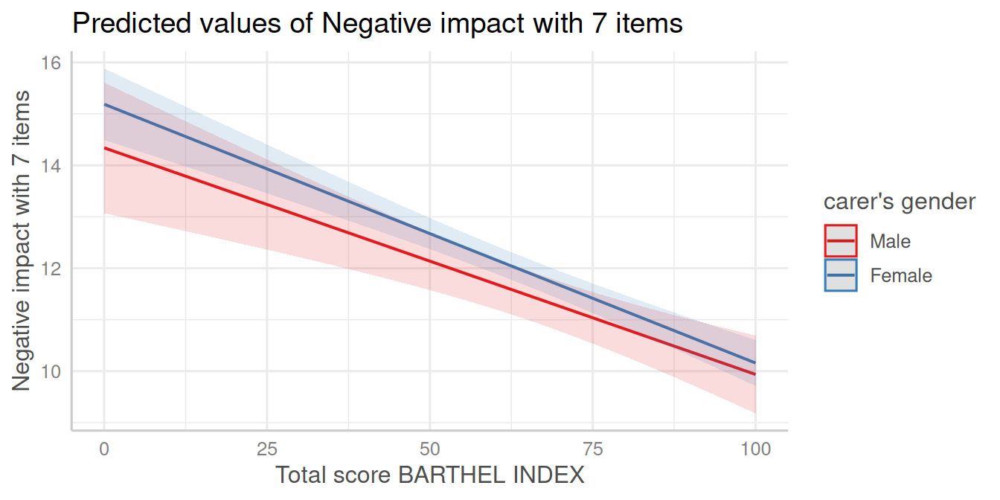
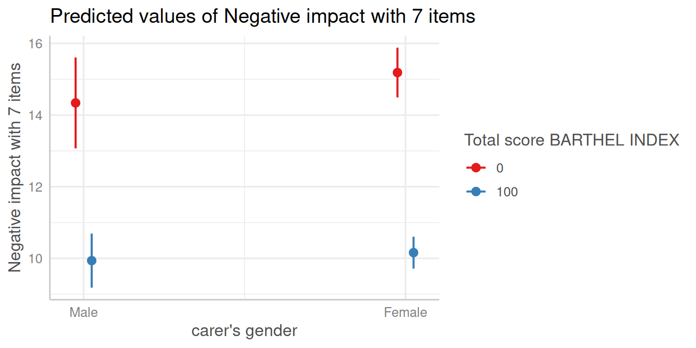
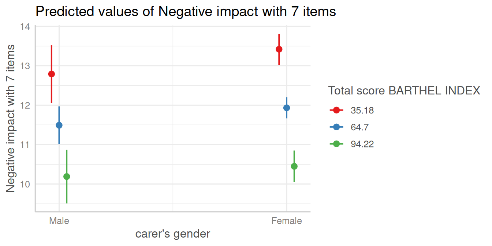
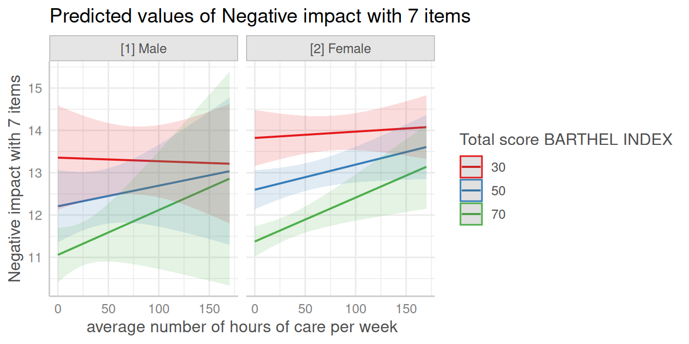
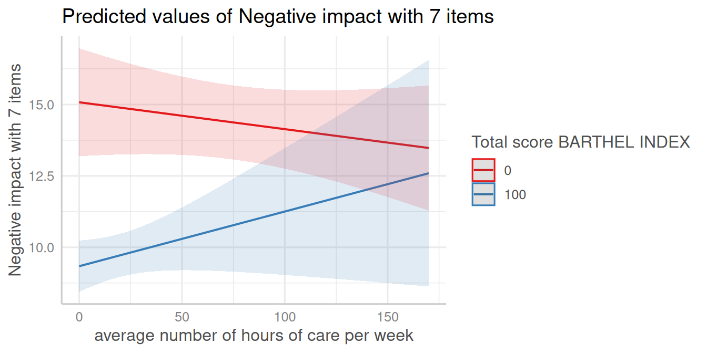
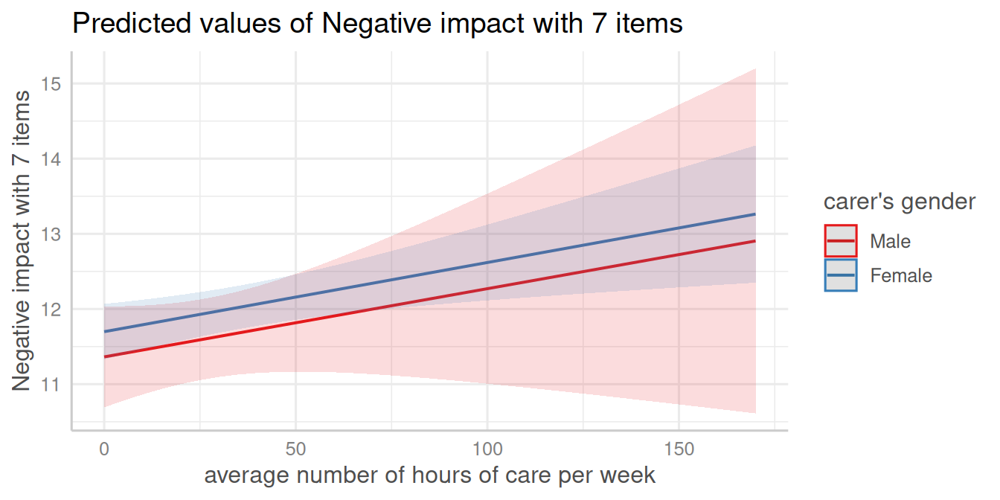
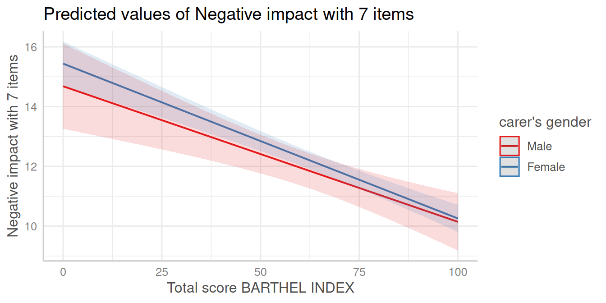
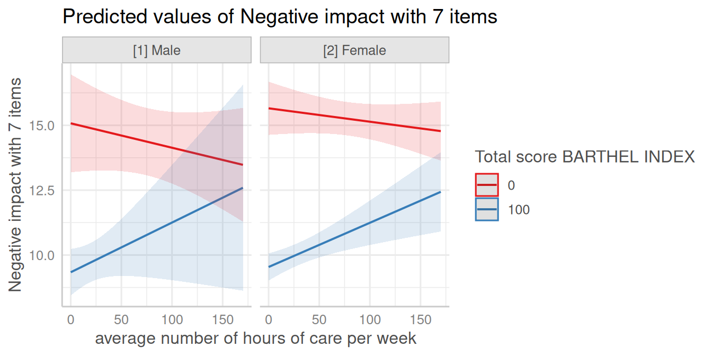

# Plotting Interaction Effects of Regression Models

This document describes how to plot marginal effects of interaction
terms from various regression models, using the
[`plot_model()`](https://strengejacke.github.io/sjPlot/reference/plot_model.md)
function.
[`plot_model()`](https://strengejacke.github.io/sjPlot/reference/plot_model.md)
is a generic plot-function, which accepts many model-objects, like `lm`,
`glm`, `lme`, `lmerMod` etc.

[`plot_model()`](https://strengejacke.github.io/sjPlot/reference/plot_model.md)
allows to create various plot tyes, which can be defined via the
`type`-argument. The default is `type = "fe"`, which means that fixed
effects (model coefficients) are plotted. To plot marginal effects of
interaction terms, call
[`plot_model()`](https://strengejacke.github.io/sjPlot/reference/plot_model.md)
with:

- `type = "pred"` to plot predicted values (marginal effects) for
  specific model terms, including interaction terms.
- `type = "eff"`, which is similar to `type = "pred"`, however, discrete
  predictors are held constant at their proportions (not reference
  level). It internally calls via .
- `type = "emm"`, which is similar to `type = "eff"`. It internally
  calls via .
- `type = "int"` to plot marginal effects of interaction terms in a more
  convenient way.

[`plot_model()`](https://strengejacke.github.io/sjPlot/reference/plot_model.md)
supports [labelled data](https://cran.r-project.org/package=sjlabelled)
and automatically uses variable and value labels to annotate the plot.
This works with most regression modelling functions.

***Note:** For marginal effects plots, **sjPlot** calls functions from
the [**ggeffects-package**](https://strengejacke.github.io/ggeffects/).
If you need more flexibility when creating marginal effects plots,
consider directly using the **ggeffects**-package.*

## Two-Way-Interactions

*Note: To better understand the principle of plotting interaction terms,
it might be helpful to read the vignette on [marginal
effects](https://strengejacke.github.io/sjPlot/articles/plot_marginal_effects.md)
first.*

To plot marginal effects of interaction terms, at least two model terms
need to be specified (the terms that define the interaction) in the
`terms`-argument, for which the effects are computed. To plot marginal
effects for three-way-interactions, all three terms need to be specified
in `terms`.

A convenient way to automatically plot interactions is `type = "int"`,
which scans the model formula for interaction terms and then uses these
as `terms`-argument.

``` r

library(sjPlot)
library(sjmisc)
library(ggplot2)
data(efc)
theme_set(theme_sjplot())

# make categorical
efc$c161sex <- to_factor(efc$c161sex)

# fit model with interaction
fit <- lm(neg_c_7 ~ c12hour + barthtot * c161sex, data = efc)

plot_model(fit, type = "pred", terms = c("barthtot", "c161sex"))
```



For `type = "int"`, no terms need to be specified. Note that this plot
type automatically uses the first interaction term in the formula for
the x-axis, while the second term is used as grouping factor.
Furthermore, if continuous variables are used as second term, you can
specify preset-values for this term with the `mdrt.values`-argument,
which are then used as grouping levels.

In this example, the second term is a factor with two levels
(male/female), so there is no need for choosing specific values for the
moderator.

``` r

plot_model(fit, type = "int")
```


To switch the terms, in this example *barthtot* and *c161sex*, simply
switch the order of these terms on the `terms`-argument and use
`type = "pred"`.

``` r

plot_model(fit, type = "pred", terms = c("c161sex", "barthtot [0, 100]"))
```


To switch the terms for plot-type `type = "int"`, you need to re-fit the
model and change the formula accordingly, i.e. using *c161sex* as first
term in the interaction.

``` r

# fit model with interaction, switching terms in formula
fit <- lm(neg_c_7 ~ c12hour + c161sex * barthtot, data = efc)
plot_model(fit, type = "int")
```



By default, for continuous variables, the minimum and maximum values are
chosen as grouping levels, which are 0 and 100 - that’s why the previous
two plots are identical. You have other options as well, e.g. the
mean-value and +/- 1 standard deviation (as suggested by Cohen and Cohen
for continuous variables and popularized by Aiken and West 1991), which
can be specified using `mdrt.values`.

``` r

plot_model(fit, type = "int", mdrt.values = "meansd")
```



## Three-Way-Interactions

Since the `terms`-argument accepts up to three model terms, you can also
compute marginal effects for a 3-way-interaction.

``` r

# fit model with 3-way-interaction
fit <- lm(neg_c_7 ~ c12hour * barthtot * c161sex, data = efc)

# select only levels 30, 50 and 70 from continuous variable Barthel-Index
plot_model(fit, type = "pred", terms = c("c12hour", "barthtot [30,50,70]", "c161sex"))
```



Again, `type = "int"` will automatically plot the interaction terms,
however, using `mdrt.values = "minmax"` as default - in this case, the
“levels” 0 and 100 from continuous variable *barthtot* are chosen by
default.

``` r

plot_model(fit, type = "int")
#> [[1]]
```



    #> 
    #> [[2]]



    #> 
    #> [[3]]



    #> 
    #> [[4]]



## References

Aiken and West (1991). *Multiple Regression: Testing and Interpreting
Interactions.*
