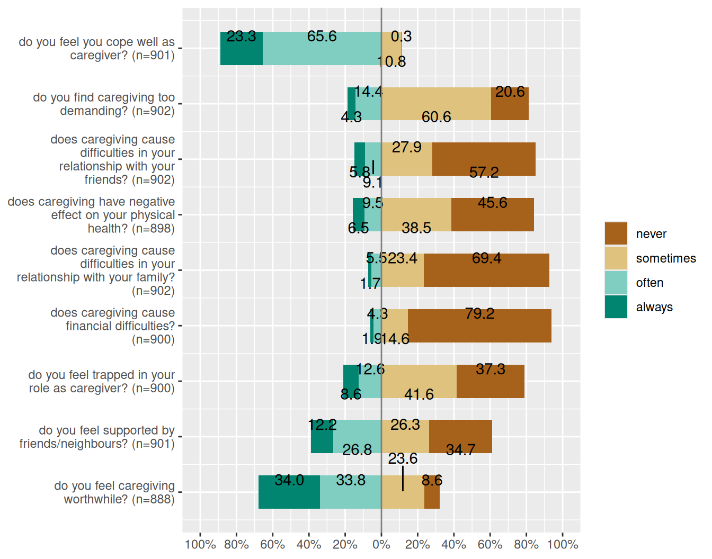
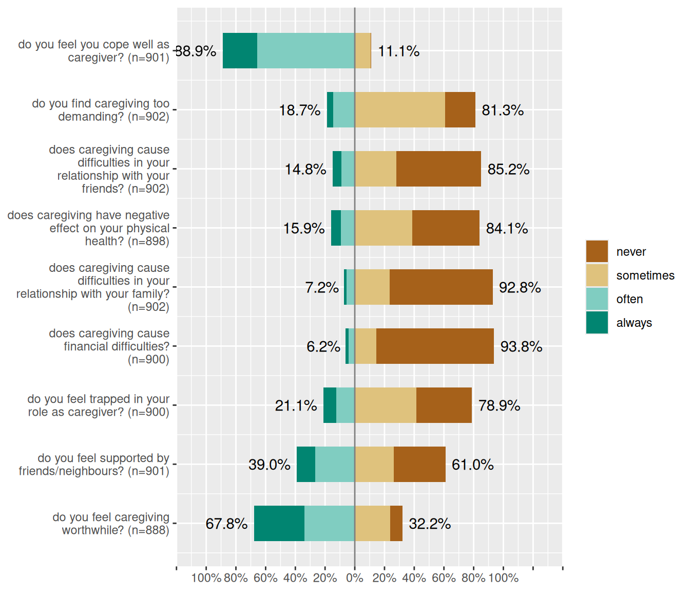
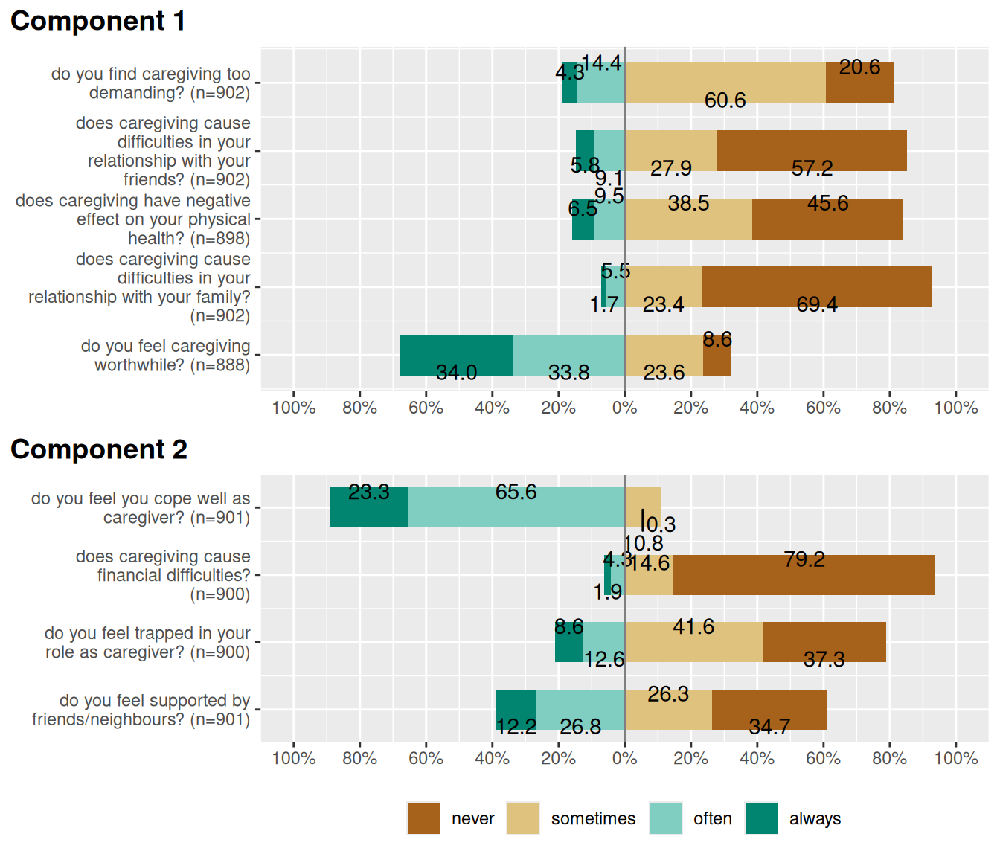
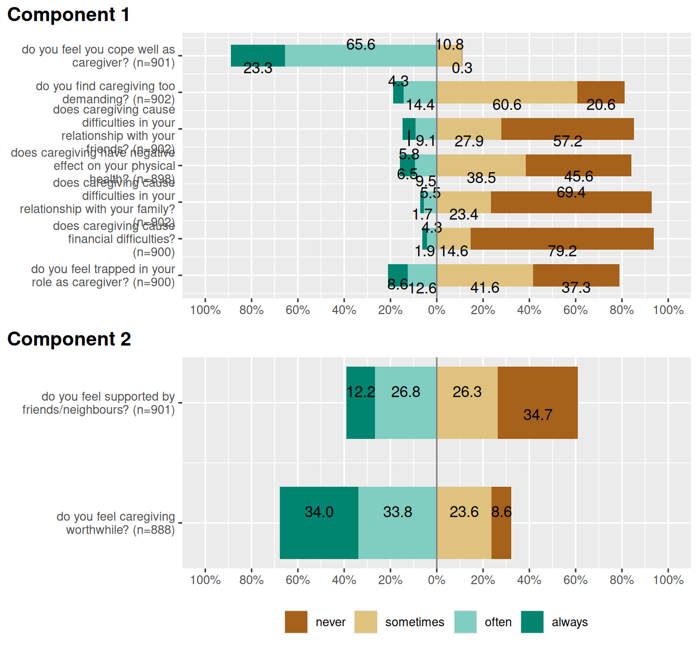
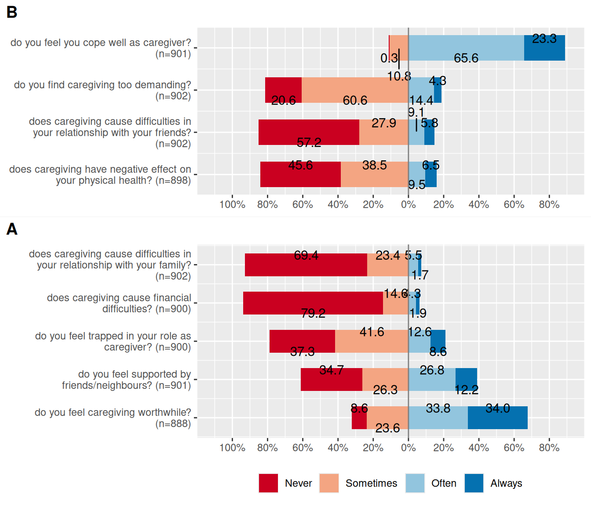
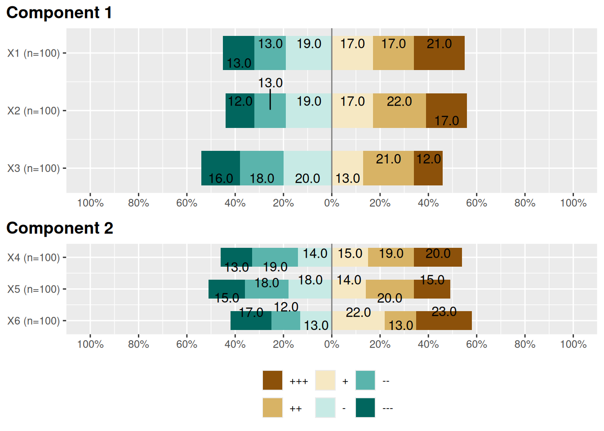
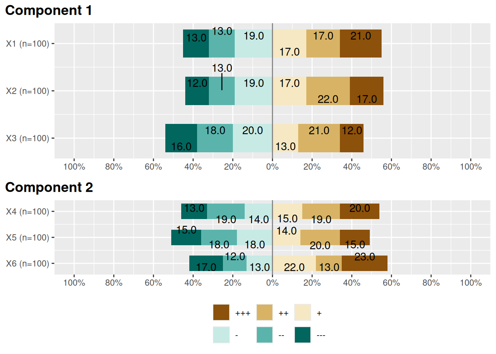

# Plotting Likert Scales

``` r

library(dplyr)
library(sjPlot)
library(sjmisc)
library(parameters)
data(efc)
# find all variables from COPE-Index, which all have a "cop" in their
# variable name, and then plot that subset as likert-plot
mydf <- find_var(efc, pattern = "cop", out = "df")
plot_likert(mydf)
```



``` r

plot_likert(
  mydf,
  grid.range = c(1.2, 1.4),
  expand.grid = FALSE,
  values = "sum.outside",
  show.prc.sign = TRUE
)
```



``` r

# Plot in groups
plot_likert(mydf, groups = c(2, 1, 1, 1, 1, 2, 2, 2, 1))
```



``` r

pca <- parameters::principal_components(mydf)
groups <- parameters::closest_component(pca)
plot_likert(mydf, groups = groups)
```



``` r

plot_likert(
  mydf,
  c(rep("B", 4), rep("A", 5)),
  sort.groups = FALSE,
  grid.range = c(0.9, 1.1),
  geom.colors = "RdBu",
  rel_heights = c(6, 8),
  wrap.labels = 40,
  reverse.scale = TRUE
)
```



``` r

# control legend items
six_cat_example = data.frame(
  matrix(sample(1:6, 600, replace = TRUE), ncol = 6)
)

six_cat_example <-
  six_cat_example |>
  dplyr::mutate_all( ~ ordered(., labels = c("+++", "++", "+", "-", "--", "---")))

# Old default
plot_likert(
  six_cat_example,
  groups = c(1, 1, 1, 2, 2, 2),
  group.legend.options = list(nrow = 2, byrow = FALSE)
)
```



``` r


# New default
plot_likert(six_cat_example, groups = c(1, 1, 1, 2, 2, 2))
```


