# Plotting Estimates (Fixed Effects) of Regression Models

This document describes how to plot estimates as forest plots (or dot
whisker plots) of various regression models, using the
[`plot_model()`](https://strengejacke.github.io/sjPlot/reference/plot_model.md)
function.
[`plot_model()`](https://strengejacke.github.io/sjPlot/reference/plot_model.md)
is a generic plot-function, which accepts many model-objects, like `lm`,
`glm`, `lme`, `lmerMod` etc.

[`plot_model()`](https://strengejacke.github.io/sjPlot/reference/plot_model.md)
allows to create various plot tyes, which can be defined via the
`type`-argument. The default is `type = "fe"`, which means that fixed
effects (model coefficients) are plotted. For mixed effects models, only
fixed effects are plotted by default as well.

``` r

library(sjPlot)
library(sjlabelled)
library(sjmisc)
library(ggplot2)

data(efc)
theme_set(theme_sjplot())
```

### Fitting a logistic regression model

First, we fit a model that will be used in the following examples. The
examples work in the same way for any other model as well.

``` r

# create binary response
y <- ifelse(efc$neg_c_7 < median(na.omit(efc$neg_c_7)), 0, 1)

# create data frame for fitting model
df <- data.frame(
  y = to_factor(y),
  sex = to_factor(efc$c161sex),
  dep = to_factor(efc$e42dep),
  barthel = efc$barthtot,
  education = to_factor(efc$c172code)
)

# set variable label for response
set_label(df$y) <- "High Negative Impact"

# fit model
m1 <- glm(y ~., data = df, family = binomial(link = "logit"))
```

### Plotting estimates of generalized linear models

The simplest function call is just passing the model object as argument.
By default, estimates are sorted in descending order, with the highest
effect at the top.

``` r

plot_model(m1)
```

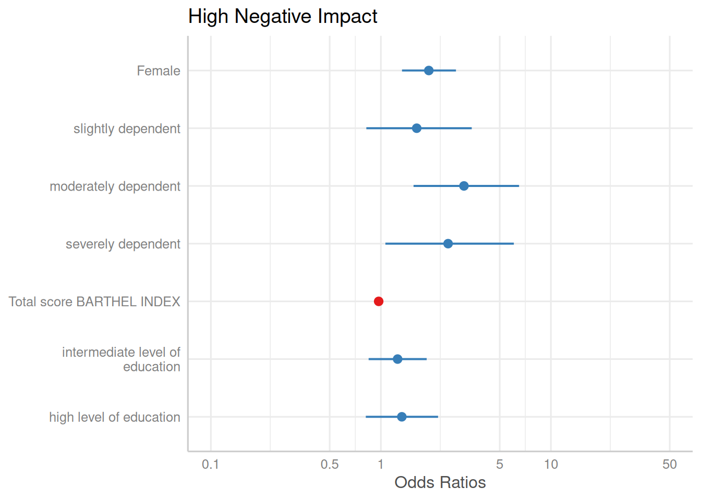

The “neutral” line, i.e. the vertical intercept that indicates no effect
(x-axis position 1 for most glm’s and position 0 for most linear
models), is drawn slightly thicker than the other grid lines. You can
change the line color with the `vline.color`-argument.

``` r

plot_model(m1, vline.color = "red")
```

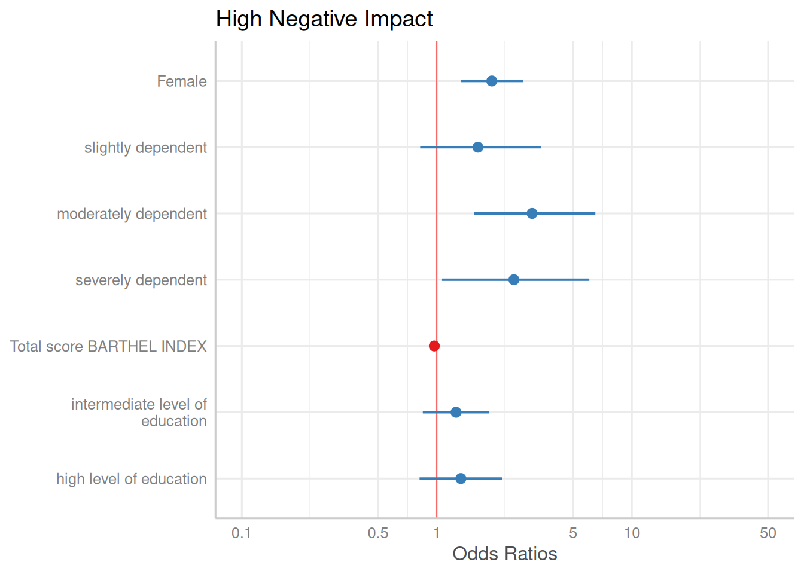

### Sorting estimates

By default, the estimates are sorted in the same order as they were
introduced into the model. Use `sort.est = TRUE` to sort estimates in
descending order, from highest to lowest value.

``` r

plot_model(m1, sort.est = TRUE)
```

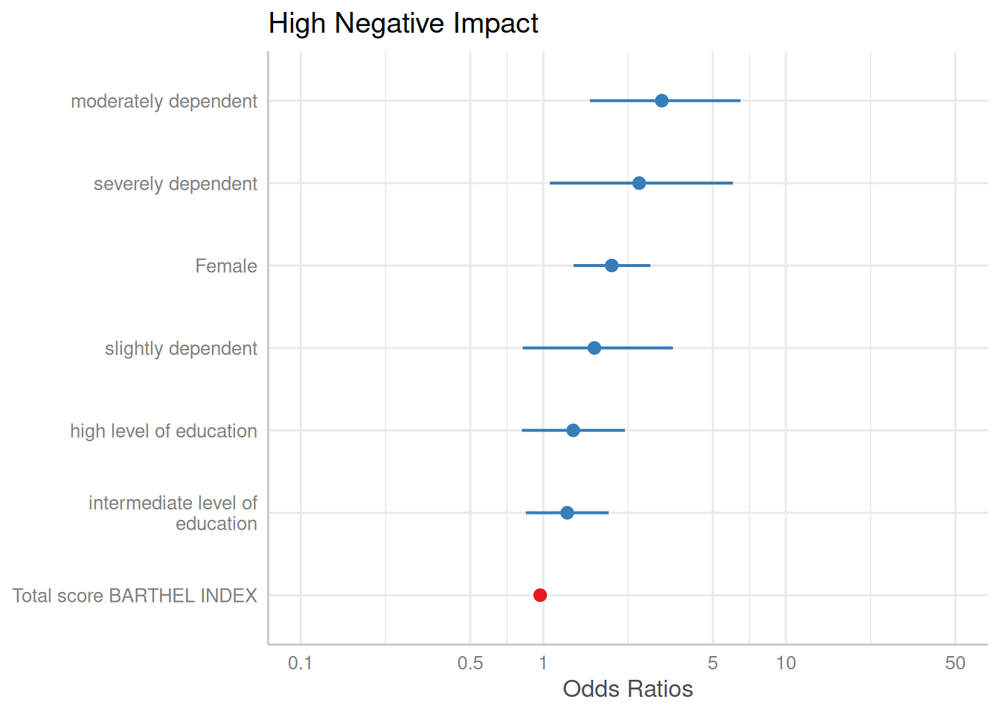

Another way to sort estimates is to use the `order.terms`-argument. This
is a numeric vector, indicating the order of estimates in the plot. In
the summary, we see that “sex2” is the first term, followed by the three
dependency-categories (position 2-4), the Barthel-Index (5) and two
levels for intermediate and high level of education (6 and 7).

``` r

summary(m1)
#> 
#> Call:
#> glm(formula = y ~ ., family = binomial(link = "logit"), data = df)
#> 
#> Coefficients:
#>              Estimate Std. Error z value Pr(>|z|)    
#> (Intercept)  0.700232   0.576715   1.214 0.224682    
#> sex2         0.649136   0.186186   3.486 0.000489 ***
#> dep2         0.485259   0.361498   1.342 0.179480    
#> dep3         1.125130   0.361977   3.108 0.001882 ** 
#> dep4         0.910194   0.441774   2.060 0.039368 *  
#> barthel     -0.029802   0.004732  -6.298 3.02e-10 ***
#> education2   0.226525   0.200298   1.131 0.258081    
#> education3   0.283600   0.249327   1.137 0.255346    
#> ---
#> Signif. codes:  0 '***' 0.001 '**' 0.01 '*' 0.05 '.' 0.1 ' ' 1
#> 
#> (Dispersion parameter for binomial family taken to be 1)
#> 
#>     Null deviance: 1122.16  on 814  degrees of freedom
#> Residual deviance:  939.77  on 807  degrees of freedom
#>   (93 observations deleted due to missingness)
#> AIC: 955.77
#> 
#> Number of Fisher Scoring iterations: 4
```

Now we want the educational levels (6 and 7) first, than gender (1),
followed by dependency (2-4)and finally the Barthel-Index (5). Use this
order as numeric vector for the `order.terms`-argument.

``` r

plot_model(m1, order.terms = c(6, 7, 1, 2, 3, 4, 5))
```

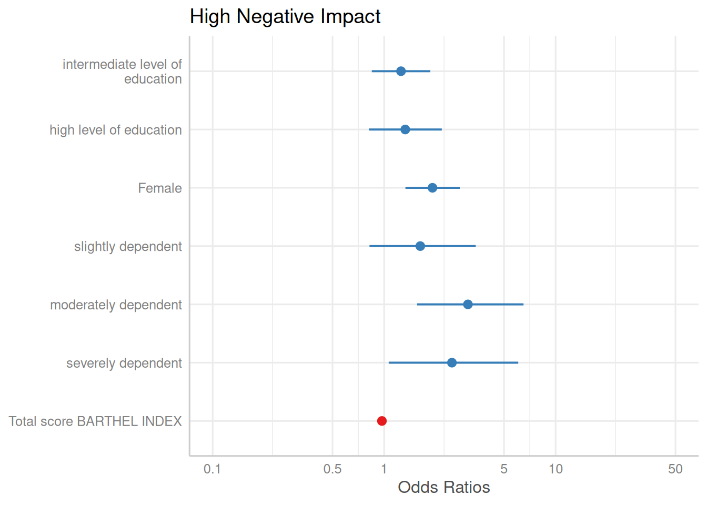

### Estimates on the untransformed scale

By default,
[`plot_model()`](https://strengejacke.github.io/sjPlot/reference/plot_model.md)
automatically exponentiates coefficients, if appropriate (e.g. for
models with log or logit link). You can explicitley prevent
transformation by setting the `transform`-argument to `NULL`, or apply
any transformation by using a character vector with the function name.

``` r

plot_model(m1, transform = NULL)
```

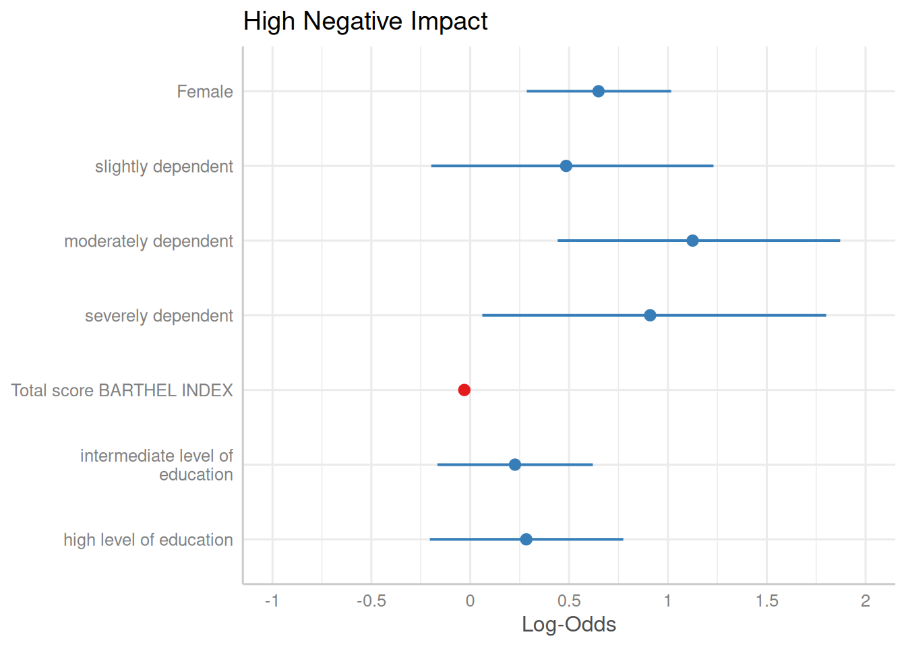

``` r

plot_model(m1, transform = "plogis")
```

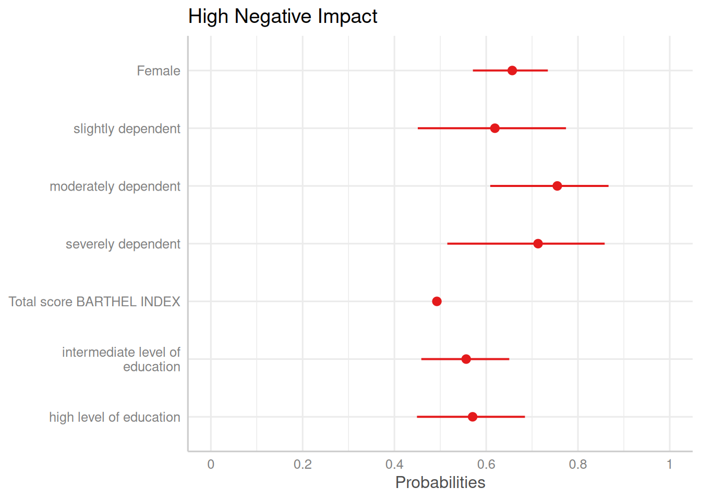

### Showing value labels

By default, just the dots and error bars are plotted. Use
`show.values = TRUE` to show the value labels with the estimates values,
and use `show.p = FALSE` to suppress the asterisks that indicate the
significance level of the p-values. Use `value.offset` to adjust the
relative positioning of value labels to the dots and lines.

``` r

plot_model(m1, show.values = TRUE, value.offset = .3)
```

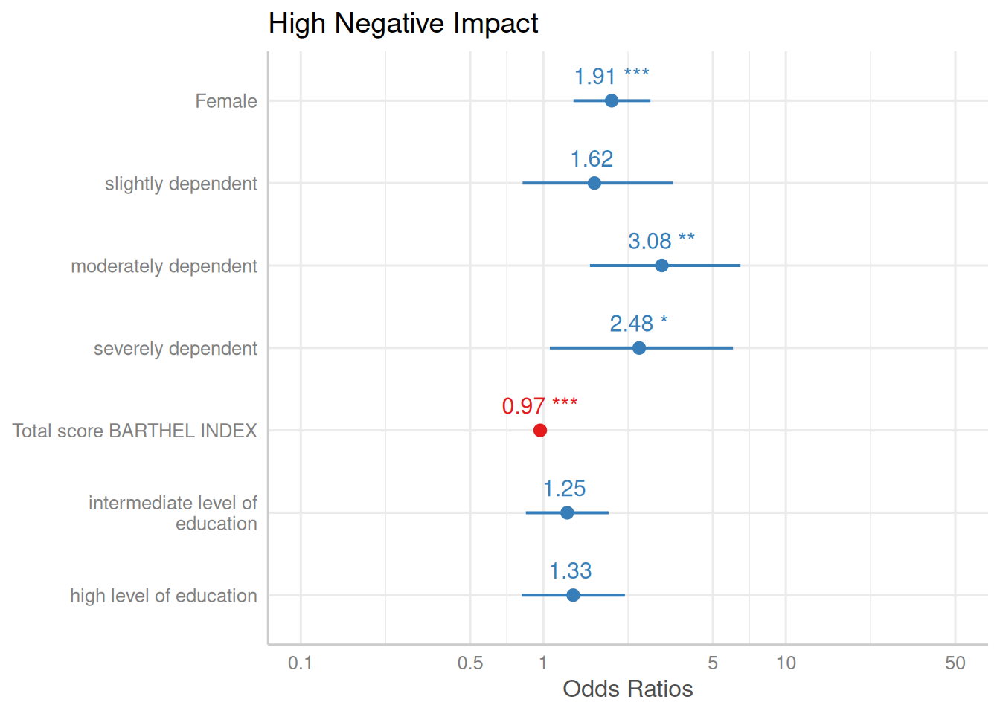

### Labelling the plot

As seen in the above examples, by default, the plotting-functions of
**sjPlot** retrieve value and variable labels if the data is *labelled*,
using the
[sjlabelled-package](https://cran.r-project.org/package=sjlabelled). If
the data is not labelled, the variable names are used. In such cases,
use the arguments `title`, `axis.labels` and `axis.title` to annotate
the plot title and axes. If you want variable names instead of labels,
even for labelled data, use `""` as argument-value,
e.g. `axis.labels = ""`, or set `auto.label` to `FALSE`.

Furthermore,
[`plot_model()`](https://strengejacke.github.io/sjPlot/reference/plot_model.md)
applies case-conversion to all labels by default, using the
[snakecase-package](https://cran.r-project.org/package=snakecase). This
converts labels into human-readable versions. Use `case = NULL` to turn
case-conversion off, or refer to the package-vignette of the
**snakecase**-package for further options.

``` r

data(iris)
m2 <- lm(Sepal.Length ~ Sepal.Width + Petal.Length + Species, data = iris)

# variable names as labels, but made "human readable"
# separating dots are removed
plot_model(m2)
```

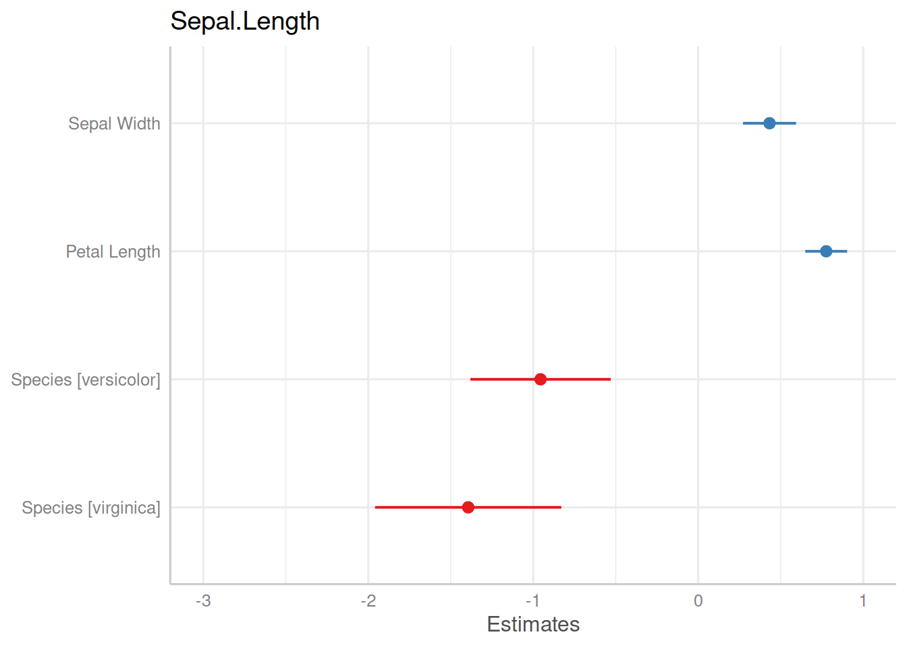

``` r

# to use variable names even for labelled data
plot_model(m1, axis.labels = "", title = "my own title")
```

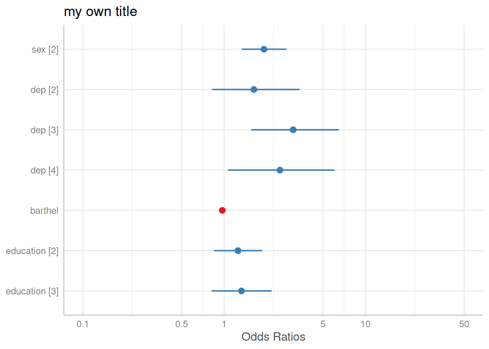

### Pick or remove specific terms from plot

Use `terms` resp. `rm.terms` to select specific terms that should (not)
be plotted.

``` r

# keep only coefficients sex2, dep2 and dep3
plot_model(m1, terms = c("sex2", "dep2", "dep3"))
```

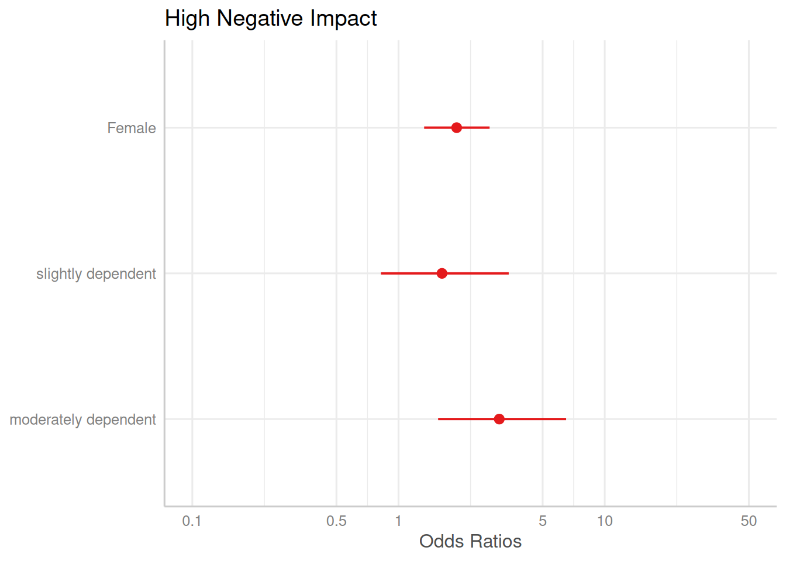

``` r

# remove coefficients sex2, dep2 and dep3
plot_model(m1, rm.terms = c("sex2", "dep2", "dep3"))
```

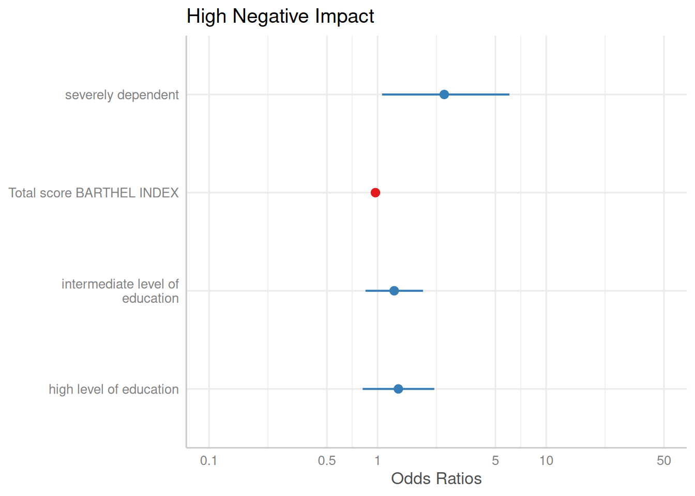

### Standardized estimates

For linear models, you can also plot standardized beta coefficients,
using `type = "std"` or `type = "std2"`. These two options differ in the
way how coefficients are standardized. `type = "std2"` plots
standardized beta values, however, standardization follows Gelman’s
(2008) suggestion, rescaling the estimates by dividing them by two
standard deviations instead of just one.

``` r

plot_model(m2, type = "std")
```

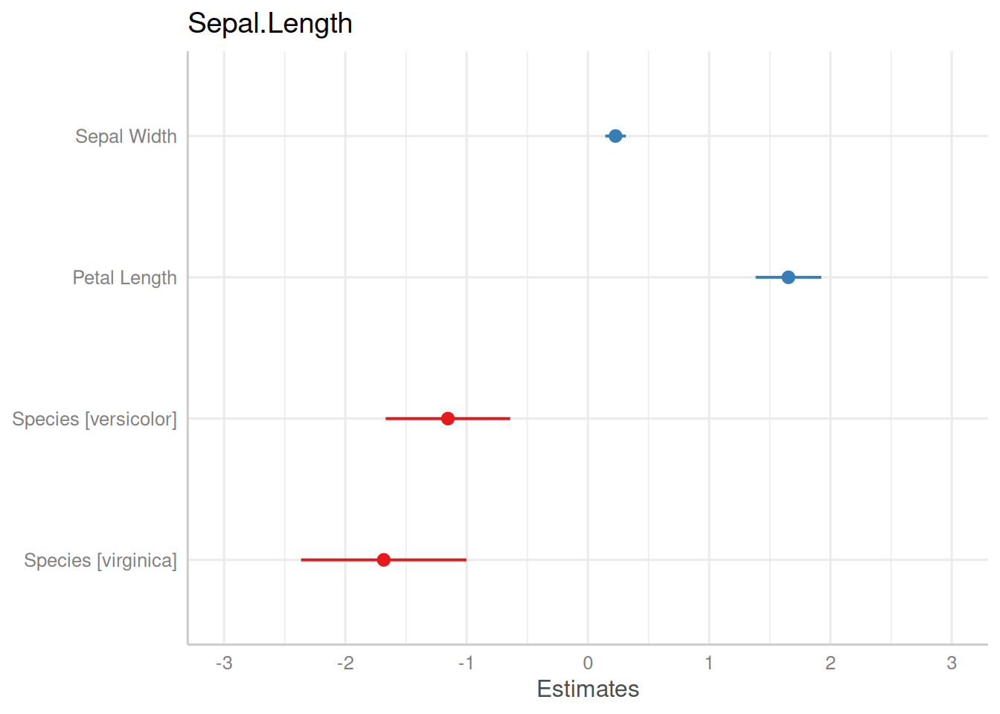

### Bayesian models (fitted with Stan)

[`plot_model()`](https://strengejacke.github.io/sjPlot/reference/plot_model.md)
also supports stan-models fitted with the **rstanarm** or **brms**
packages. However, there are a few differences compared to the previous
plot examples.

First, of course, there are no *confidence intervals*, but *uncertainty
intervals* - high density intervals, to be precise.

Second, there’s not just one interval range, but an *inner* and *outer*
probability. By default, the inner probability is fixed to `.5` (50%),
while the outer probability is specified via `ci.lvl` (which defaults to
`.89` (89%) for Bayesian models). However, you can also use the
arguments `prob.inner` and `prob.outer` to define the intervals
boundaries.

Third, the point estimate is by default the *median*, but can also be
another value, like mean. This can be specified with the `bpe`-argument.

``` r

if (require("rstanarm", quietly = TRUE)) {
  # make sure we apply a nice theme
  library(ggplot2)
  theme_set(theme_sjplot())

  data(mtcars)
  m <- stan_glm(mpg ~ wt + am + cyl + gear, data = mtcars, chains = 1)

  # default model
  plot_model(m)
  # same model, with mean point estimate, dot-style for point estimate
  # and different inner/outer probabilities of the HDI
  plot_model(
    m,
    bpe = "mean",
    bpe.style = "dot",
    prob.inner = .4,
    prob.outer = .8
  )
}
```

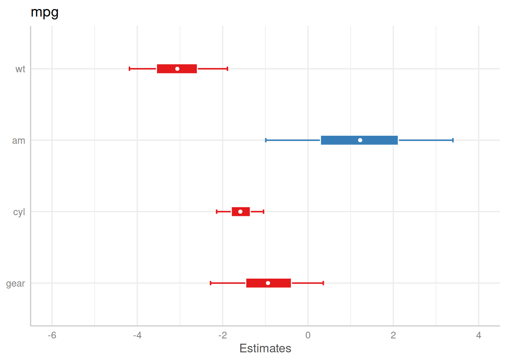

### Tweaking plot appearance

There are several options to customize the plot appearance:

- The `colors`-argument either takes the name of a valid [colorbrewer
  palette](https://colorbrewer2.org/) (see also the related
  [vignette](https://strengejacke.github.io/sjPlot/articles/custplot.md)),
  `"bw"` or `"gs"` for black/white or greyscaled colors, or a string
  with a color name.
- `value.offset` and `value.size` adjust the positioning and size of
  value labels, if shown.
- `dot.size` and `line.size` change the size of dots and error bars.
- `vline.color` changes the neutral “intercept” line.
- `width`, `alpha` and `scale` are passed down to certain ggplot-geoms,
  like
  [`geom_errorbar()`](https://ggplot2.tidyverse.org/reference/geom_linerange.html)
  or `geom_density_ridges()`.

``` r

plot_model(
  m1,
  colors = "Accent",
  show.values = TRUE,
  value.offset = .4,
  value.size = 4,
  dot.size = 3,
  line.size = 1.5,
  vline.color = "blue",
  width = 1.5
)
```

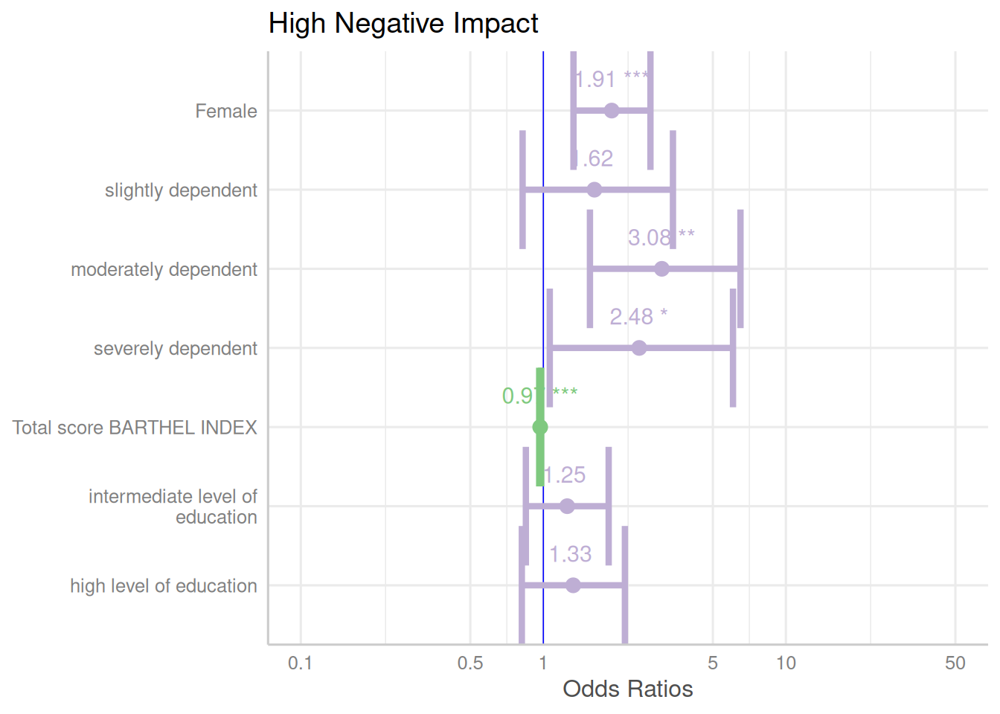

## References

Gelman A (2008) *Scaling regression inputs by dividing by two standard
deviations.* Statistics in Medicine 27: 2865–2873.
